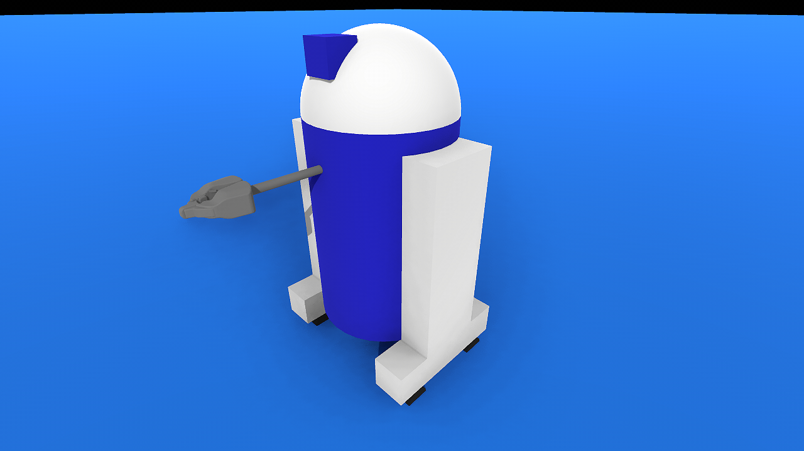
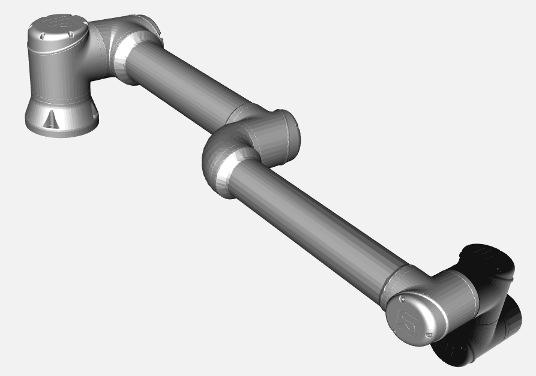

# URDFModelica
Standalone simple Modelica URDF robots

## Abstract
The DLR URDFModelica Library is a free open-source library for simulation of robots described as URDF. Given a robot URDF description, a python script translates it to Modelica syntax and automatically builds a package structure to simulate this robot in Modelica. Alternatively a generic robot simulation can be parameterized based on a single Modelica record.

URDFModelica received the  of the [16th International Modelica & FMI Conference](https://modelica.org/events/modelica2025/).

## Introduction
**URDFModelica** is a library to convert robot designs into multibody simulation models based on the **U**nified **R**obot **D**escription **F**ormat **URDF**, see [ROS 2 Documentation](http://docs.ros.org/en/jazzy/Tutorials/Intermediate/URDF/URDF-Main.html) and [ROS Wiki](https://wiki.ros.org/urdf).

Many CAD software have functionalities to export their models as URDF file, an XML file with known convention and markings, that define properties of links and joints. A Python script in this library's resources converts the URDF file to packages of Modelica files: parameter records and models for links and joints, overall models that connect the links and joints together.

An example mobile robot comes along the library [07-physics.urdf](https://github.com/ros/urdf_tutorial/blob/ros2/urdf/07-physics.urdf). 

An example stationary robot comes along the library [UR10e](https://www.universal-robots.com/products/ur10e/) and [ur10e.urdf](https://github.com/Daniella1/urdf_files_dataset/blob/main/urdf_files/ros-industrial/xacro_generated/universal_robots/ur_description/urdf/ur10e.urdf). 

Visualization can be done in two ways, with visualizers from the Standard Library or from the [DLR Visualization 2 library](https://www.sr-scil.de/simulationsbibliotheken/kommerziell-verfuegbar/visualization/), the free community edition suffices to run the examples.

There are three folders in the repository:

- **URDFModelica** is the full Modelica library with all models, resources and examples.
- **URDFModelica_Tutorial** is the same Modelica library without examples. With this package, interested users can follow the tutorials for mobile, stationary and generic rover in the [Modelica Documentation Tutorial](https://github.com/DLR-RM/urdfmodelica/tree/main/URDFModelica_Tutorial/Documentation). There are no difference to the full library otherwise.
- **doc** has some background information about the example robots. Publications, further tutorial files and other relevant documents will be added there if applicable.

## User's Guide
This is a step by step guide of how to set up a simulation of a robot described as URDF file. Please refer to the URDF export function of CAD software for how to create the URDF (XML) file and associated meshes. The [ROS 2 documentation export page](http://docs.ros.org/en/jazzy/Tutorials/Intermediate/URDF/Exporting-an-URDF-File.html) may be of good advice.

### Prerequisites
The library has been developed and tested on OpenModelica v1.27.1 and Dymola 2026x. Visualizers from the DLR Visualization 2 library only work well with Dymola but OpenModelica begins to get supported as of the second half of 2026. Similarly, the generic robot simulation from a single record only works with Dymola but fixing the issue is actively worked on as of the second half of 2026.

The Python code has been developed and tested with Python 3.12 from the official sources. The module [urdf_parser_py](https://github.com/ros/urdf_parser_py) has been installed with pip.

### User's guide
Given a valid URDF robot. You may need to change paths for visual meshes. Note that not all file types are supported by visualization, `.stl` in ASCII mode has been successfully tested. Collision currently (first version of the library) are not simulated, only their geometry (transparently with Visualization 2) visualized on top of the visual robot model. This can be disabled through a Boolean parameter. Mobile robots additionally are not fixed to space but free to move, the leaves of their kinematic chains (in general wheels) are prevented from falling beneath the (x, y) plane at `z=0`. Stationary robots are connected to the multibody World. It's best to save all files in the resources folder of the library. Note also that all names will be converted to title form (First letter upper case, the rest lower case) and should not contain \"-\" (minus) signs.

Open a terminal, cmd respectively, and navigate to the folder with the URDF file. Run the Python script `python urdf_to_package.py`
- `-i` URDF input file
- `-o` output file of translation from URDF to Modelica record in one file (default is robot name in current folder)
- `-r` root directory (where the Modelica package structure begins)
- `-p` package the Modelica package where the new package will be placed (e.g. `URDFModelica\Examples`)
- `-v` use DLR Visualization 2 instead of Standard Library visualizers
- `-s` mark robot as stationary (i.e. rigidly connect it to the world origin)
- `-g` skip the automatic package generation, only translate from URDF to Modelica and save the output file (options `-r`, `-p`, `-v`, `-s` and `-u` have no effect)

A new package will be created there with subpackages
- Links
- Joints
that each contain one parameter record and one model for each link, respectively joint. Three further files are
- `Robotname` where links and joints are inserted and connected to each other and provided with outside connects. The only difference between mobile (no `-s` option) and stationary (with `-s` option) is the icon. The interface has one Multibody frame_a on the left connected to the root link of the robot, a vector of Multibody frame_b to the right connected to all links that are leaves of the robot kinematic chains, and flanges of all rotational and translational joints at the top.
- `RobotnameRun` where the robot is given an environment (Multibody World) and interface to the active joints (translational and rotational position sources), this can be a good model for FMU export. A mobile robot (no `-s` option) has a free motion between World and robot. Further, the leaves of kinematic chains are connected to collisionPoints (see Links explanation) to prevent mobile robots (their kinematic chains in general end with wheels) from falling through the ground. This is done with elastoGaps from the standard library. A stationary robot (with `-s` option) is connected to the Multibody World. Option `-v` disables the Standard Library Visualizers and includes the DLR Visualization 2 setup.
- `RobotnameTest` sets some inputs for `RobotnameRun` to quickly check that the package was built correctly.

Mobile robot example: `python ..\urdf_to_package.py -i physics.urdf -o physics.mo -r C:\Username\ModelicaLibraries -p URDFModelica\Examples`

Stationary robot example: `python ..\urdf_to_package.py -i ur10e.urdf -r C:\Username\ModelicaLibraries -p URDFModelica\Examples -s`

Stationary robot example with DLR Visualization 2: `python ..\urdf_to_package.py -i ur10e.urdf -r C:\Username\ModelicaLibraries -p URDFModelica\Examples_Visualization2 -s -v`

There is a last input argument to the Python script `python urdf_to_package.py`
- `-u` Instead of creating or overwriting the whole package, an existing package of links, joints and robot gets its parameter values updated. The model files are not changed, only the parameter records for links and joints are completely overwritten. For this to work, the robot package structure must already exist, otherwise an error message is returned and nothing changed. This option can be useful if you have altered a few link or joint models (e.g. introduce further effects such as joint flexibility) and in the meantime some URDF parameters changed (e.g. different mass and inertia of links). The update option then changes only the parameters and keeps your model changes.

## Detailed Library Description
The detailed library description, including the elaborate example, is in the [Modelica Documentation](https://github.com/DLR-RM/urdfmodelica/tree/main/URDFModelica/Documentation).

## Reference Results
Reference results for the library examples can be found in [urdfmodelica-referenceresults](https://github.com/DLR-RM/urdfmodelica-referenceresults).

## Contact
Antoine Pignède [@afxp](https://github.com/afxp) 
Carsten Oldemeyer [@CarstenOldemeyer](https://github.com/CarstenOldemeyer) 
Deutsches Zentrum f&uuml;r Luft und Raumfahrt e.V. (DLR) 
Robotik- und Mechatronikzentrum (RMC) 
M&uuml;nchener Stra&szlig;e 20 
D-82234 Wessling, Germany 
